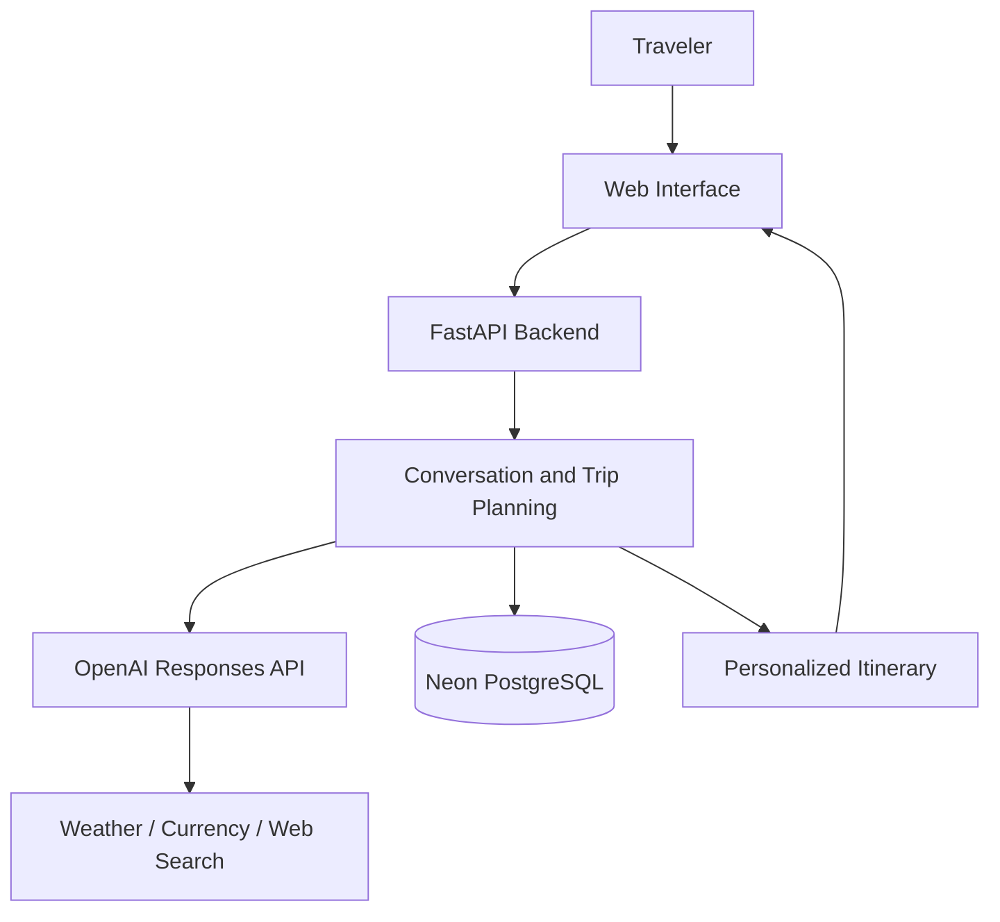

# TravelAdvisor AI

An AI-powered travel companion that turns your trip ideas into personalized itineraries through natural conversation.

## Project Overview

TravelAdvisor AI helps travelers plan trips around their interests, available time, and preferences. Users describe where they want to go, and the assistant asks relevant follow-up questions before creating a complete day-by-day travel plan.

The application brings together itinerary planning, weather forecasts, currency conversion, and travel research. Users can revisit saved conversations, refine their plans, and download their itinerary for later use.

## Main Features

- **Personalized trip planning** — Tailored recommendations based on destination, duration, interests, traveler count, budget, and preferences.
- **Conversational assistance** — Follow-up questions to collect missing details and clarify ambiguous requests.
- **Complete itineraries** — Trip title, summary, daily activities, practical travel tips, and estimated budget.
- **Weather forecasts** — Check destination weather to support travel decisions.
- **Currency conversion** — Convert travel expenses between currencies.
- **Web-assisted travel research** — Retrieve external information for travel-related questions.
- **Saved trips** — Reopen previous conversations and revise existing itineraries.
- **Usage dashboard** — View recorded AI requests, token consumption, and estimated API costs.
- **Itinerary export** — Download travel plans in Markdown format.

## Live Demo

**Frontend demo URL:(https://travel-advisor-frontend.vercel.app/)

## Project Architecture



## AI and Tool Integration

The assistant uses conversation context and saved trip details to create personalized plans. Structured outputs are validated with Pydantic, while tool calling and web search provide external information for weather, currency conversion, and travel research.

## Technologies Used

| Category | Tools and Technologies |
| --- | --- |
| Frontend | HTML, CSS, JavaScript |
| Backend | Python, FastAPI |
| Generative AI | OpenAI Responses API |
| Data Validation | Pydantic |
| Database | Neon PostgreSQL, Psycopg |
| External Integrations | Weather forecasts, currency exchange, web search |
| Testing | pytest |
| Deployment | Vercel |

## Project Structure

```text
travel-advisor/
├── frontend/                 # Web interface
│   ├── index.html
│   ├── script.js
│   └── style.css
├── src/                      # Application services
│   ├── ai_service.py
│   ├── conversation_service.py
│   ├── schemas.py
│   ├── database.py
│   ├── repository.py
│   ├── tools.py
│   ├── usage_service.py
│   └── security_service.py
├── tests/                    # Database and security-behavior tests
├── notebooks/                # API experiments
├── docs/                     # Technical documentation
├── server.py                 # API entry point
├── requirements.txt
└── README.md
```

## Run Locally

### 1. Clone the repository and install dependencies

```bash
git clone https://github.com/haripriya91/travel-advisor.git
cd travel-advisor
pip install -r requirements.txt
```

### 2. Configure environment variables

Create a `.env` file in the project root:

```dotenv
OPENAI_API_KEY=your_api_key
OPENAI_MODEL=your_available_model_id
DATABASE_URL=your_neon_connection_string
```

Add any additional settings required by your configured tools. Keep `.env` out of version control and initialize the database tables using `src/database.py` before first use.

### 3. Start the backend

```bash
uvicorn server:app --reload
```

API documentation: http://localhost:8000/docs

### 4. Start the frontend

In another terminal, from the project root:

```bash
python -m http.server 5500 --directory frontend
```

Open http://localhost:5500.

For local backend development, set the frontend API base URL to `http://localhost:8000` and allow `http://localhost:5500` in backend CORS. Local UI development can also use the deployed backend.

## Testing

Tests cover database operations, input validation, tool-call validation, and selected conversation behaviors.

```bash
python -m pytest tests/test_security.py -v
```

Use a dedicated test database before running database tests:

```bash
python -m pytest tests/test_database.py -v
```

## Documentation

- [Architecture](docs/architecture.md)
- [AI Workflow](docs/ai_workflow.md)
- [Security Analysis](docs/security_analysis.md)

## Future Improvements

- Automatic summarization to preserve relevant context in longer conversations.
- Optional AI-generated destination and itinerary images.
- PDF itinerary export.
- Flight and hotel availability, transport research, and booking integrations.
- Model comparison and task-specific model selection to balance quality, latency, and cost.
- User accounts with private trip histories.
- Expanded security controls, usage limits, and automated testing.

Travel budgets and AI-generated recommendations are planning estimates; confirm important details before booking.

## Author

Haripriya Pushpamangalam Kesavan , Anita Kiran

## References

- [OpenAI API](https://platform.openai.com/docs)
- [FastAPI](https://fastapi.tiangolo.com/)
- [Pydantic](https://docs.pydantic.dev/)
- [Neon PostgreSQL](https://neon.com/docs)
- [Vercel](https://vercel.com/docs)
- [Open-Meteo](https://open-meteo.com/)
