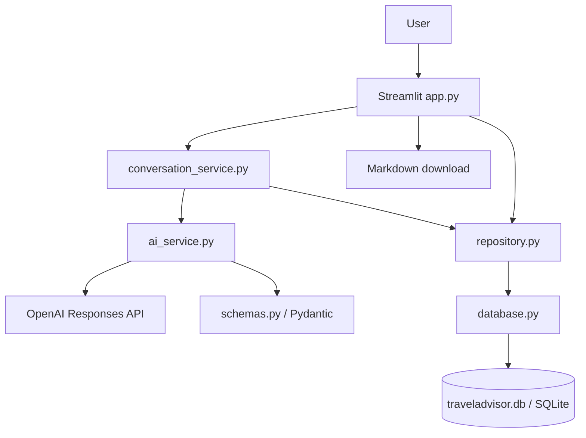

# Architecture — TravelAdvisor AI

## Current architecture (Phase 1)

## Responsibilities

| Module | Responsibility |
| --- | --- |
| `app.py` | Displays saved chats and itineraries; receives user input; exports Markdown |
| `conversation_service.py` | Saves user messages, loads state, decides whether to ask a question or generate a plan |
| `ai_service.py` | Calls OpenAI for a structured conversation turn and, separately, for a structured itinerary |
| `schemas.py` | Defines trip, activity, day, and itinerary models and validates day count |
| `repository.py` | Reads/writes conversations, messages, trip state, and itineraries |
| `database.py` | Opens SQLite connections and creates tables |

## Data flow

1. User sends a message through Streamlit.
2. Conversation service saves the message and loads prior trip state plus recent messages.
3. AI service requests a structured `TravelTurn` from OpenAI.
4. Conversation service saves updated `TripState` and checks required fields.
5. If generation is requested and allowed, AI service requests `TravelItinerary`.
6. Pydantic validates the itinerary, which is then saved to SQLite.
7. Streamlit loads and displays the saved itinerary and offers Markdown export.

## Database tables

- `conversations`: conversation ID, title, creation and update timestamps
- `messages`: role, text, conversation association, timestamp
- `trips`: serialized trip state, optional itinerary JSON, status
