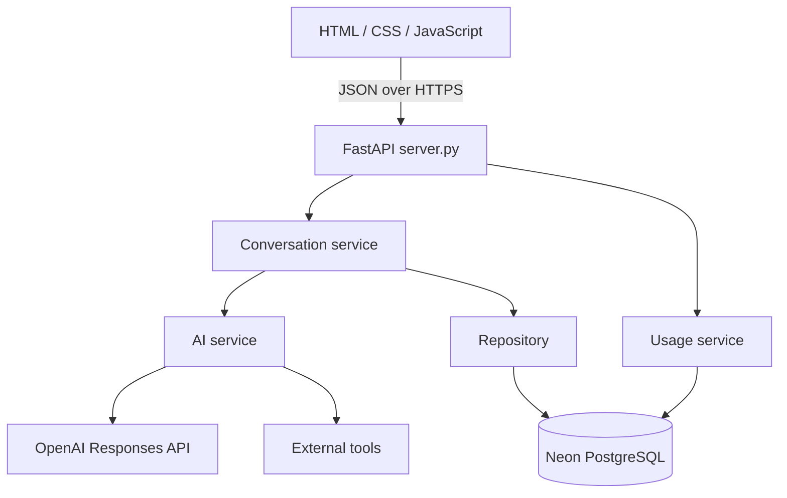
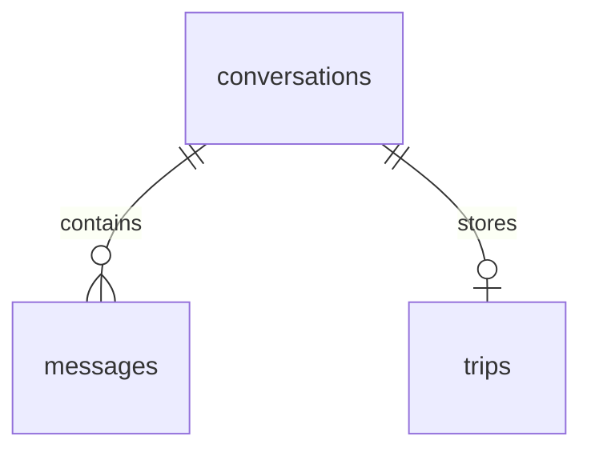

# Architecture

The application separates browser presentation, API routes, conversation orchestration, external AI/tools, and database access.

## Responsibilities

| Component | Responsibility |
| --- | --- |
| frontend | Render chat, itinerary, tools, usage; send API requests |
| server.py | Validate request bodies; expose routes and HTTP errors; configure CORS |
| conversation_service.py | Load context, orchestrate AI calls, decide generation, persist changes |
| ai_service.py | Model instructions, structured outputs, tool integration |
| schemas.py | Validate trip and itinerary structures |
| repository.py | Read/write conversations, messages, trip state, itineraries |
| database.py | PostgreSQL connection and table setup |
| tools.py | Weather and currency provider calls |
| usage_service.py | Recorded token/request usage and estimated cost reporting |
| security_service.py | Message and tool-call validation |

## Database

Confirmed tables are `conversations`, `messages`, `trips`, and `api_usage`. Conversations are the parent of messages and trips. Both child foreign keys use `ON DELETE CASCADE`, so deleting a conversation also removes its related messages and trip record.

`api_usage` stores usage records; its exact columns and any relationships must be checked in the current database schema. No relationship is assumed here. Trip state and itineraries are stored as serialized structured data; consult the current schema for PostgreSQL column types.

## Deployment boundary

One GitHub repository feeds two Vercel projects. The frontend root is `frontend`; the backend root is the repository root. Backend credentials stay in backend environment variables. The frontend's public API URL selects the backend. CORS permits the exact frontend origin.

Local and deployed backends share data only when they target the same Neon branch/database. Use isolated test connections to avoid modifying deployed data.
